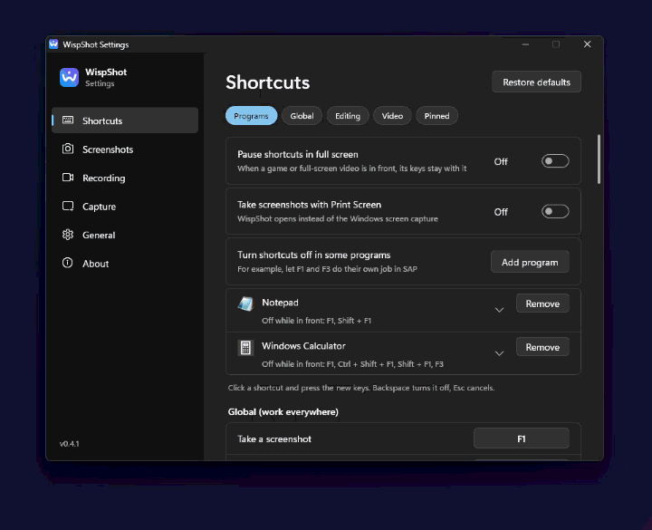
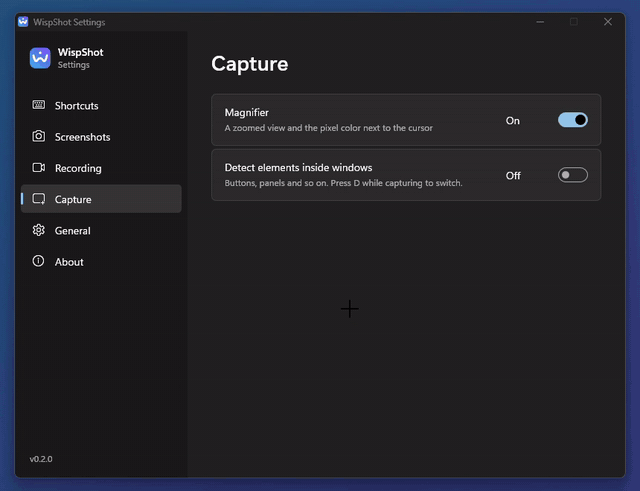
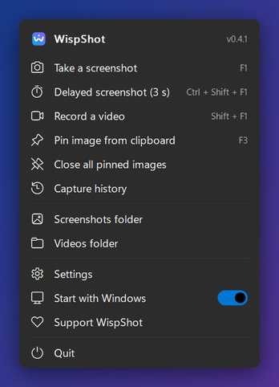
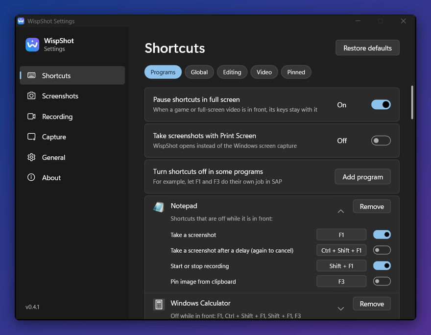

<p align="center">
  
</p>

<h1 align="center">WispShot</h1>

<p align="center">
  A screenshot and screen recording tool for Windows that stays out of your way.<br>
  One small exe, about 2 MB of memory and zero CPU while it waits. It keeps itself up to date.
</p>

<p align="center">
  Free, with no ads or telemetry. If it helps you, <a href="https://github.com/sponsors/efekaputlu">sponsor its development</a>.
</p>

<p align="center">
  <a href="https://github.com/WispShot/wispshot/actions/workflows/ci.yml"></a>
  <a href="https://github.com/WispShot/wispshot/releases/latest"></a>
  <a href="LICENSE"></a>
  
  
  <a href="https://github.com/sponsors/efekaputlu"></a>
</p>

<p align="center">
  <b>English</b> · <a href="README.tr.md">Türkçe</a>
</p>

<p align="center">
  
</p>

## Why WispShot

Most screenshot tools are fine at taking screenshots. The trouble is everything they do the rest of the day:
background processes, tens of megabytes of memory, sometimes a whole runtime. WispShot sits in the tray and does
nothing until you press the key.

| | WispShot 0.2 | Snipaste 2.11 | Flameshot 14 | Snow Shot 1.4 |
|---|---|---|---|---|
| Download size | **0.8 MB** (one exe) | 47 MB | 95 MB | 177 MB |
| Processes while idle | **1** | 1 | 1 | 4 |
| Memory while idle, after one screenshot (private) | **1.9 MB** | 61 MB | 9 MB | 22 MB |
| Memory while idle, after one screenshot (working set) | **0.7 MB** | 102 MB | 47 MB | 94 MB |
| CPU time in 30 s of idle | **0.000 s** | 0.031 s | 0.047 s | 0.031 s |
| Key press to the dimmed capture screen (median of 10) | **154 ms** | 194 ms | 201 ms¹ | 209 ms |

WispShot also puts a blank veil on screen about 4 ms after the key press, so the press never feels ignored, and
it catches any clicks you make before the editor is ready.

¹ Flameshot only covers the monitor under the cursor; the others cover every monitor.

Measured on 10 November 2026 on one laptop (Windows 11, two 1080p monitors, one at 125%), each app on its own with
default settings, using [`tools/bench/bench.ps1`](tools/bench/bench.ps1). The latency test presses the shortcut and
times how long it takes until the screen visibly changes. Your numbers will differ; the gap in memory won't by much.

## Made for a working day

A few things you won't find together anywhere else:

- **It gets out of the way of the programs you work in.** List a program such as SAP, Excel or a game launcher, choose
  which shortcuts it keeps (SAP's F1 help and F3 back are also WispShot's defaults), and they go to that program
  while it is in front. Full-screen games and videos get the same treatment on their own.
- **Text recognition that reads your language.** OCR uses the engine built into Windows, but picks the right
  language for the text and enlarges small screen text first: on an English Windows, Turkish UI text went from 15-18% wrong
  characters to about 1%, without any download.
- **Privacy built in.** `Ctrl+B` finds e-mail addresses, phone numbers, IBANs, card, ID and tax numbers and API keys in
  a capture and blurs them in one step. Nothing leaves your PC unless you press Upload, and there is no telemetry.
- **Find any old screenshot by the words in it**, with the searchable history kept on your own disk.
- **Draw on a video while you record**, with marks that fade by themselves.
- **Small and quiet, and stays current.** About 2 MB of memory while idle; once a day it asks GitHub for a new
  version and installs it in one click after checking its SHA-256.

## Features

**Capture**
- Region capture on a global shortcut: the screen freezes and everything outside your selection dims
- Automatic window detection; press `D` to pick individual parts of a window instead
- Move and resize the selection with handles or the arrow keys, with a live size label
- Magnifier with the pixel color under the cursor (`C` copies it as `#RRGGBB`)
- Copy without clicking first: press `Enter` and the window under the cursor is copied

**Annotate**
- Rectangle, ellipse, arrow, line, pen, highlighter, text, numbered steps
- Blur and pixelate: paint them on like a brush, or hold `Shift` and drag a rectangle
- Scroll to change the width, with a live preview at the cursor
- Hold `Ctrl` to move or delete any drawing, or several at once; double-click text to edit it again
- Unlimited undo and redo
- **Frame**: a margin, rounded corners and a shadow on a colorful, light or dark background, so a capture looks
  tidy in a chat or a document (`F`)
- **Hide sensitive info** (`Ctrl+B`): finds e-mail addresses, phone numbers, IBANs, card numbers, ID and tax numbers (TCKN, VKN)
  and API keys with Windows OCR and blurs them in one step (checksums keep ordinary numbers untouched)
- **Scrolling capture**: scroll a long page inside the selected area (or let *Auto* do it) and get one tall image

**Share**
- Copy to the clipboard, or **copy as a file** to paste straight into Explorer, email or chat apps
- Save as PNG, JPG, BMP or TIFF, either asking every time or straight into a folder
- **Upload** (`Ctrl+U`) to a host that needs no account or key and copy the link: [Uguu](https://uguu.se)
  (deleted after 3 hours, the IP is forgotten with the file) or [Litterbox](https://litterbox.catbox.moe) (1 or 3
  days), or your own server. Nothing leaves your PC until you press it, and the first time it asks you
- Pin an image on top of other windows; zoom it, make it see-through, copy it again later
- **OCR** with the text recognition built into Windows: nothing to download. It reads with the right language
  (Turkish, German, French...) and switches to English for English text, and tells you if Windows is missing
  the language pack
- **Searchable history** (off by default): the last captures stay on your PC and you can find one by the text
  in it, for example every screenshot that says "invoice". Old ones can be deleted after a day, a week or a month

**Record**
- Record any area to MP4 (H.264) with the GPU's own encoder (Intel Quick Sync, NVIDIA NVENC, AMD AMF),
  or to an animated GIF
- **Draw on the recording** while it runs: pen, highlighter, arrows, boxes and step numbers that fade after a few
  seconds, or stay if you prefer. They end up in the video, the toolbar doesn't
- Works with rotated and portrait monitors, and records the cursor

<p align="center">
  
</p>

**Everything else**
- Every shortcut can be changed in Settings, with a bar to jump between its sections
- **Turn shortcuts off in chosen programs**, one by one: pick the program from the ones open (shown with their
  icons and names) and switch off only the keys it needs
- **Print Screen** can take the screenshot: WispShot turns off the Windows screen capture for that key and gives it
  back when you switch it off
- Shortcuts step aside while a full-screen game or video is in front, so they reach that app instead
- **Updates itself**: a daily check (one request to GitHub, can be turned off) and a one-click, checksum-verified
  install that keeps your settings
- English and Turkish interface, light and dark theme (or follow Windows)
- Settings live in a plain `wispshot.ini` next to the exe, so it's portable

## Getting started

Get the latest version from the [Releases](../../releases/latest) page, in one of two forms:

- **Installer** (`WispShot-<version>-setup-x64.exe`): installs for your user only, with no admin rights needed. It adds
  a Start menu entry and an uninstaller, and can start WispShot with Windows.
- **Portable** (`WispShot-<version>-portable-x64.zip`): unzip anywhere and run `wispshot.exe`. Settings stay in
  `wispshot.ini` next to it, so the folder works from a USB stick too.

Then:

1. Run it. An icon appears in the tray; nothing else happens until you need it.
2. Press `F1` to take a screenshot, or `Shift+F1` to record an area.

The files aren't code-signed yet, so Windows SmartScreen may say it "protected your PC" the first time. Choose
*More info* > *Run anyway*. Every release lists SHA-256 checksums and is built from this repository by
[GitHub Actions](.github/workflows/release.yml), with a build provenance attestation you can check with
`gh attestation verify <file> --repo WispShot/wispshot`.

**Updates.** Once a day WispShot asks GitHub whether a new version is out (one request to github.com, nothing
about you or your captures is sent). When there is one, the tray icon says so; click it and the installed version
downloads the setup, checks it against the release's SHA-256 list, installs it and starts again. The portable copy
opens the release page instead. Turn it off under *Settings > General*, or with `winget upgrade WispShot.WispShot`
once it is in WinGet.

Right-click the tray icon for Settings, where you can change shortcuts, choose where files are saved and turn on
*Start with Windows*.

<p align="center">
  
  &nbsp;
  
</p>

**Requirements:** Windows 10 (version 2004 or newer) or Windows 11, 64-bit (x64). On Windows 11 for Arm the x64 build
runs through Windows' built-in emulation. Developed and tested on Windows 11.
For OCR, Windows needs a text recognition language installed
(*Settings > Time & language > Language & region*), which is usually already there for your display language.

## Shortcuts

These are the defaults. All of them except the fixed keys (`Esc`, `Enter`, arrows, `Delete` and typing in a text box)
can be changed under *Settings > Shortcuts*.

| Anywhere | |
|---|---|
| `F1` | Take a screenshot |
| `Ctrl+Shift+F1` | Take a screenshot after a few seconds (again to cancel), for menus and tooltips |
| `Shift+F1` | Start or stop recording an area |
| `F3` | Pin the image on the clipboard to the screen |
| `Shift+F2` (while recording) | Draw on the recording |

| In the capture editor | |
|---|---|
| Drag / click | Select an area / select the detected window |
| `Enter`, `Ctrl+C`, double-click | Copy and close |
| `Ctrl+Shift+C` | Copy as a file |
| `Ctrl+S` | Save |
| `Ctrl+T` | Pin to screen |
| `Ctrl+O` | Copy the text in the selection (OCR) |
| `Ctrl+R` | Record the selected area |
| `Ctrl+L` | Scrolling capture of the selected area |
| `Ctrl+B` | Blur sensitive info (e-mail, phone, IBAN, card, key) |
| `Ctrl+U` | Upload and copy the link |
| `Ctrl+A` | Select the current monitor (again: all monitors) |
| `R` `E` `A` `L` `U` `P` `M` `T` `N` `X` `B` | Rectangle, ellipse, arrow, line, ruler, pen, highlighter, text, numbered step, pixelate, blur |
| `Ctrl+Z` / `Ctrl+Y` | Undo / redo |
| Right-click / `Esc` | Go back a step / close |

<details>
<summary>More editor shortcuts</summary>

| | |
|---|---|
| `Shift` while drawing | Straight lines at 45° steps, squares and circles |
| `Shift` + drag with blur or pixelate | Rectangle instead of a brush |
| Mouse wheel | Line width or brush size |
| `Ctrl` + drag on a drawing | Move it (a selected one moves with all selected drawings) |
| `Ctrl` + click, then `Delete` | Select a drawing and delete it (holding `Ctrl`, `Delete` removes the one under the cursor) |
| `Ctrl` + click more drawings | Add them to the selection, or take them out |
| `Ctrl` + drag on empty space | Select every drawing the rectangle touches |
| `Ctrl+Shift+A` | Select all drawings |
| Arrow keys on selected drawings | Nudge by 1 px (`Shift`: 10 px) |
| Double-click text, or `F2` on selected text | Edit the text, its color and size |
| Arrow keys / `Shift` + arrow keys | Move / resize the selection by 1 px |
| `C` (before selecting) | Copy the color under the cursor |
| `D` | Detect parts of windows, not just whole windows |

The text box works like a normal one: click to place the caret, drag or `Shift` + arrows to select, double-click a
word, `Ctrl+A`, `Ctrl+←/→`, `Home`/`End`, `Ctrl+C/X/V`, `Ctrl+Backspace`, and its own undo.
</details>

<details>
<summary>Drawing on a recording</summary>

| | |
|---|---|
| *Draw* on the recording bar | Opens the toolbar: pen, highlighter, arrow, box, step number, four colors |
| `P` `M` `A` `R` `N`, `1` to `4` | Tool, color |
| Mouse wheel | Width |
| `F` | Let drawings fade after about 3 seconds (default) or keep them. Step numbers always stay |
| `Ctrl+Z`, `Delete` | Undo the last drawing, clear everything |
| `Esc`, right-click, *Done* | Stop drawing; the mouse goes back to the app underneath |
</details>

<details>
<summary>Pinned images</summary>

| | |
|---|---|
| Drag | Move |
| Mouse wheel / `Ctrl` + wheel | Zoom / opacity |
| `0` | Actual size |
| Right-click | Copy, copy as file, save, OCR, close |
| Double-click / `Esc` | Close |
</details>

From the command line: `wispshot.exe --capture`, `--record`, `--pin` or `--exit` talk to the running tray app.

## Settings

Changes in the Settings window apply right away; there's no Save button. Everything is stored in `wispshot.ini`
next to the exe (or in `%APPDATA%\WispShot` if that folder isn't writable). You can also edit it by hand
(*Settings > General > Settings file* opens it); it applies as soon as you save, and your comments are kept.

<details>
<summary>wispshot.ini reference</summary>

| Key | Values |
|---|---|
| `[output] save_mode` | `ask` (default) or `folder` |
| `[output] save_dir`, `notify` | Empty means `Pictures\WispShot`; `true` / `false` |
| `[record] save_mode` | `folder` (default) or `ask`. If you cancel the dialog, the video goes to the default folder instead of being lost |
| `[record] video_dir`, `notify`, `fps`, `cursor` | Empty means `Videos\WispShot` |
| `[record] ink_fade` | `true`: drawings on a recording fade after a few seconds |
| `[general] language` | `system`, `en` or `tr` |
| `[general] theme` | `system`, `light` or `dark` |
| `[hotkeys]` | Global shortcuts, including `record_draw` |
| `[hotkeys] pause_in_fullscreen` | `true` (default): while a full-screen app is in front, the shortcuts are released. A running recording can still be stopped |
| `[keys] editor.*`, `draw.*`, `pin.*` | Shortcuts inside the editor, while drawing on a recording, and on pinned images |
</details>

If another app already holds a shortcut (Snow Shot uses `F1`, for example), WispShot tells you and you can pick
another one.

## How it stays light

The same exe runs in two roles.

- **The tray app** only owns the tray icon and the global shortcuts. It blocks in `GetMessage`: no timers,
  no polling, no hooks, no worker threads. About 2 MB.
- **A session process** starts for each screenshot or recording and exits when its last window closes. Direct2D,
  WIC, OCR and the video encoder are only ever loaded here. This matters more than it sounds: some GPU drivers keep
  140 to 180 MB around after Direct2D is used, and the only reliable way to get it back is to end the process.
  If a session crashes, the tray app is unaffected.

Pinned images and OCR results can stay open for hours, so they are handed over to a fresh process that never loaded
Direct2D (about 2.5 MB for a pinned image).

For speed, the tray app shows a transparent veil the moment you press the key (it's excluded from screen capture,
so it never ends up in the shot). Clicks and drags on it are passed on to the editor once it's ready, so you can
start selecting before the editor has finished loading.

## Building from source

You need Rust with the GNU toolchain and MinGW-w64 (for `dlltool` and `windres`).

```sh
winget install Rustlang.Rustup
rustup toolchain install stable-x86_64-pc-windows-gnu
rustup default stable-x86_64-pc-windows-gnu
winget install BrechtSanders.WinLibs.POSIX.UCRT
./build.sh          # builds target/release/wispshot.exe
```

A running tray app locks its exe, so build test copies elsewhere (`./build.sh --target-dir target/t`) and start a
session directly: `target/t/release/wispshot.exe --session capture 0` (also `record` and `settings`). Set
`WISP_TRACE=1` to write a timing log to `%TEMP%\wispshot-trace.log`.

`wispshot.exe --selftest <folder>` runs every Windows API the app relies on (screen grab, Direct2D, image encoding,
OCR, H.264) without opening a window and writes a report to that folder; CI runs it on every push.
`tools/package.ps1` builds the portable zip and the installer (needs [Inno Setup 6](https://jrsoftware.org/isinfo.php)).

To add a language, copy `lang/en.txt`, translate the values and add it to `LANGS` in `src/i18n.rs`.

<details>
<summary>Source layout</summary>

| File | What's in it |
|---|---|
| `main.rs` | Tray app: shortcuts, autostart, starting sessions, full-screen detection |
| `traymenu.rs` | The tray menu, drawn with GDI only |
| `session.rs` | Session process: actions, recording lifecycle, hand-over, exiting when done |
| `veil.rs` | The instant veil and input forwarding |
| `overlay.rs` | Selection and the capture editor (GDI first frame, then Direct2D) |
| `capture.rs` | Screen grab, window and element detection |
| `gfx.rs`, `textedit.rs` | Drawing model, Direct2D helpers, export; the text box |
| `img.rs` | Image buffer, blur, pixelate |
| `output.rs` | Clipboard (image, file, text), encoding, save dialog |
| `pin.rs` | Pinned images (plain GDI) |
| `ocr.rs` | Windows OCR and its result window |
| `record.rs` | Video recording (Desktop Duplication, Direct2D, Media Foundation H.264) |
| `recui.rs`, `ink.rs`, `layered.rs` | Recording bar and frame, drawing on recordings, layered window helper |
| `settings.rs` | Settings window (Direct2D, its own process) |
| `config.rs`, `keys.rs`, `i18n.rs` | `wispshot.ini`, the shortcut table, interface text |
| `logo.rs` | The logo, drawn in code for the tray icon and Settings |
</details>

## Known limitations

- Scrolling capture follows downward scrolling only.
- You can move, delete and edit text drawings, but not yet change the color or width of other drawings.
- Recordings have no audio and cover a single monitor (an area is clipped to its monitor).
- While recording, the GPU driver can take around 180 MB and part of a CPU core on busy content. It all goes away
  when the recording ends.
- Windows only. Capture and windowing are written straight against Win32.

## Support WispShot

<a href="https://github.com/sponsors/efekaputlu"></a>

WispShot is free and stays free, with no ads, accounts or telemetry. It is built and kept up in spare time, one small
exe at a time. If it saves you time, sponsoring through [GitHub Sponsors](https://github.com/sponsors/efekaputlu) pays
for the next feature, the next fix and the next release, starting from $3 a month or a one-time $5.

No money to spare? That's fine too:

- Give the repository a star. It helps others find WispShot.
- Tell a friend or a colleague who takes screenshots all day.
- [Report a bug or suggest an idea](https://github.com/WispShot/wispshot/issues).

## Star history

<a href="https://star-history.com/#WispShot/wispshot&Date">
  <picture>
    <source media="(prefers-color-scheme: dark)" srcset="https://api.star-history.com/svg?repos=WispShot/wispshot&type=Date&theme=dark">
    
  </picture>
</a>

## License

Copyright (C) 2026 Efe Kaputlu. WispShot is free software under the [GNU General Public License v3.0](LICENSE) or
any later version. You can use, study, change and share it. If you share a changed version, it has to stay under the
same license with its source code available.
