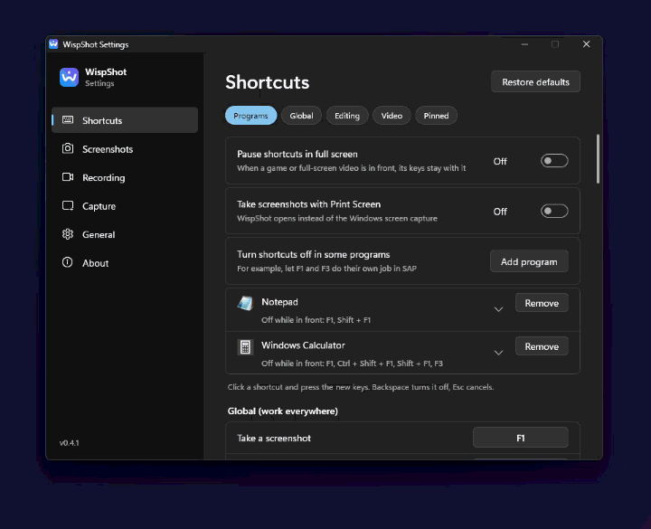
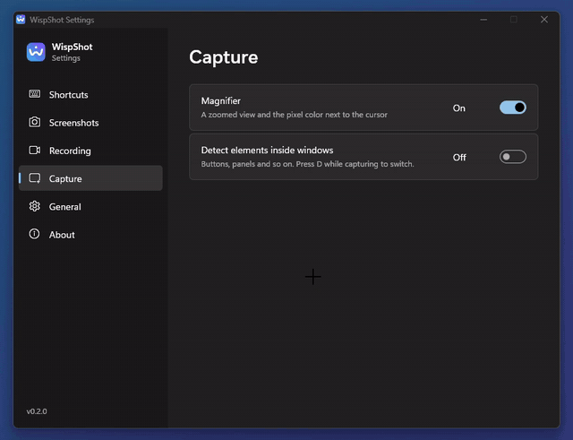
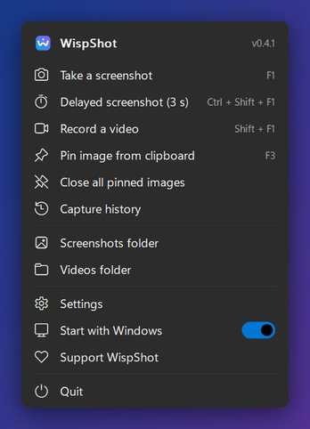
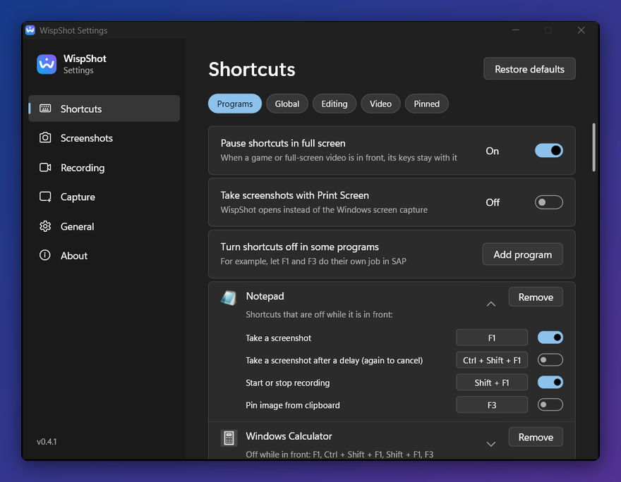

<p align="center">
  
</p>

<h1 align="center">WispShot</h1>

<p align="center">
  Windows için, ihtiyacınız olana kadar ortalıkta görünmeyen bir ekran görüntüsü ve ekran kaydı aracı.<br>
  Tek küçük exe, kurulum yok; beklerken yaklaşık 2 MB bellek ve sıfır işlemci.
</p>

<p align="center">
  Ücretsiz, reklamsız, telemetrisiz. İşinize yarıyorsa <a href="https://github.com/sponsors/efekaputlu">geliştirilmesine destek olun</a>.
</p>

<p align="center">
  <a href="https://github.com/WispShot/wispshot/actions/workflows/ci.yml"></a>
  <a href="https://github.com/WispShot/wispshot/releases/latest"></a>
  <a href="LICENSE"></a>
  
  
  <a href="https://github.com/sponsors/efekaputlu"></a>
</p>

<p align="center">
  <a href="README.md">English</a> · <b>Türkçe</b>
</p>

<p align="center">
  
</p>

## Neden WispShot

Ekran görüntüsü araçlarının çoğu ekran görüntüsü almakta iyidir. Sorun, günün geri kalanında yaptıklarıdır:
arka plan süreçleri, onlarca megabayt bellek, kimi zaman koca bir çalışma zamanı. WispShot tepside durur ve tuşa
basana kadar hiçbir şey yapmaz.

| | WispShot 0.2 | Snipaste 2.11 | Flameshot 14 | Snow Shot 1.4 |
|---|---|---|---|---|
| İndirme boyutu | **0,8 MB** (tek exe) | 47 MB | 95 MB | 177 MB |
| Boştayken süreç sayısı | **1** | 1 | 1 | 4 |
| Bir çekimden sonra boştaki bellek (özel) | **1,9 MB** | 61 MB | 9 MB | 22 MB |
| Bir çekimden sonra boştaki bellek (çalışma kümesi) | **0,7 MB** | 102 MB | 47 MB | 94 MB |
| 30 sn boşta işlemci süresi | **0,000 sn** | 0,031 sn | 0,047 sn | 0,031 sn |
| Tuşa basıştan karartılmış çekim ekranına (10 denemenin ortancası) | **154 ms** | 194 ms | 201 ms¹ | 209 ms |

WispShot ayrıca tuşa bastıktan yaklaşık 4 ms sonra ekrana boş bir perde koyar; böylece tuş basışı hiç yok sayılmış
gibi hissettirmez ve düzenleyici hazır olmadan yaptığınız tıklamalar kaybolmaz.

¹ Flameshot yalnızca imlecin olduğu monitörü kaplar; diğerleri bütün monitörleri.

10 Kasım 2026'da tek bir dizüstünde ölçüldü (Windows 11, iki 1080p monitör, biri %125), her uygulama tek başına ve
varsayılan ayarlarla, [`tools/bench/bench.ps1`](tools/bench/bench.ps1) ile. Gecikme testi kısayola basar ve ekranın
gözle görülür biçimde değişmesine kadar geçen süreyi ölçer. Sizin sonuçlarınız farklı olacaktır; bellekteki fark
pek değişmez.

## Özellikler

**Yakalama**
- Global kısayolla bölge yakalama: ekran donar, seçimin dışı kararır
- Pencereleri otomatik algılar; `D` ile pencerenin içindeki parçaları da seçebilirsiniz
- Seçimi tutamaçlarla ya da ok tuşlarıyla taşıyıp boyutlandırma, anlık boyut etiketi
- Büyüteç ve imlecin altındaki pikselin rengi (`C` rengi `#RRGGBB` olarak kopyalar)
- Tıklamadan kopyalama: `Enter`'a basın, imlecin altındaki pencere kopyalanır

**Üzerine çizme**
- Dikdörtgen, elips, ok, çizgi, kalem, fosforlu kalem, metin, numaralı adım
- Bulanıklaştırma ve mozaik: fırça gibi boyayın ya da `Shift` basılıyken dikdörtgen çizin
- Tekerlekle kalınlık, imleçte anlık önizleme
- `Ctrl` basılı tutarak herhangi bir çizimi ya da birkaçını birden taşıyın veya silin; metne çift tıklayıp yeniden düzenleyin
- Sınırsız geri al ve yinele
- **Paylaşım çerçevesi**: renkli, açık ya da koyu arka planda boşluk, yuvarlak köşe ve gölge (`F`)
- **Hassas bilgileri gizleme** (`Ctrl+B`): e-posta, telefon, IBAN, kart numarası, T.C. kimlik no ve API
  anahtarlarını Windows OCR ile bulup tek adımda bulanıklaştırır (sağlama hanesi denetimi sıradan sayılara dokunmaz)
- **Kaydırmalı çekim**: seçili alanda uzun bir sayfayı kaydırın (ya da *Otomatik*e bırakın), tek bir uzun görüntü alın

**Paylaşma**
- Panoya kopyalama ya da **dosya olarak kopyalama**: doğrudan Explorer'a, e-postaya, sohbet uygulamalarına yapıştırılır
- PNG, JPG, BMP veya TIFF olarak kaydetme; her seferinde sorarak ya da doğrudan bir klasöre
- Resmi diğer pencerelerin üstüne sabitleme; yakınlaştırma, saydamlaştırma, sonra yeniden kopyalama
- Windows'un kendi metin tanıma motoruyla **OCR**: indirilecek bir şey yok
- **Aranabilir geçmiş** (varsayılan kapalı): son çekimler bilgisayarınızda kalır, içindeki yazıyla bulunur;
  örneğin içinde "fatura" geçen tüm ekran görüntüleri. Eskiler bir gün, bir hafta ya da bir ay sonra silinebilir

**Kayıt**
- Herhangi bir bölgeyi ekran kartının kendi kodlayıcısıyla MP4'e (H.264) kaydetme
  (Intel Quick Sync, NVIDIA NVENC, AMD AMF) ya da hareketli GIF olarak kaydetme
- **Kayıt sürerken üzerine çizme**: kalem, fosforlu kalem, ok, çerçeve ve adım numaraları birkaç saniyede
  silinir ya da isterseniz kalır. Çizimler videoya girer, araç çubuğu girmez
- Döndürülmüş ve dikey monitörlerle çalışır, imleci de kaydeder

<p align="center">
  
</p>

**Diğerleri**
- Bütün kısayollar Ayarlar'dan değiştirilebilir
- İngilizce ve Türkçe arayüz, açık ve koyu tema (ya da Windows'u izlesin)
- Önde tam ekran bir oyun ya da video varken kısayollar kenara çekilir, tuşlar o uygulamaya gider
- Ayarlar exe'nin yanındaki düz bir `wispshot.ini` dosyasında durur, yani taşınabilir

## Başlarken

Son sürümü [Releases](../../releases/latest) sayfasından iki biçimden biriyle indirin:

- **Kurulum** (`WispShot-<sürüm>-setup-x64.exe`): yalnızca sizin kullanıcınız için kurar, yönetici izni istemez.
  Başlat menüsüne ekler, kaldırıcısı vardır ve isterseniz WispShot'ı Windows ile başlatır.
- **Taşınabilir** (`WispShot-<sürüm>-portable-x64.zip`): istediğiniz yere açıp `wispshot.exe`'yi çalıştırın. Ayarlar
  yanındaki `wispshot.ini` dosyasında durur; klasör bir USB bellekten de çalışır.

Sonra:

1. Çalıştırın. Tepside bir simge belirir; ihtiyacınız olana kadar başka bir şey olmaz.
2. Ekran görüntüsü için `F1`'e, bir bölgeyi kaydetmek için `Shift+F1`'e basın.

Dosyalar henüz kod imzalı değil; Windows SmartScreen ilk seferde "bilgisayarınızı korudu" diyebilir. *Ek bilgi* >
*Yine de çalıştır* deyin. Her sürümde SHA-256 sağlamaları bulunur ve sürümler bu depodan
[GitHub Actions](.github/workflows/release.yml) ile derlenir; derleme kaynağı belgesini
`gh attestation verify <dosya> --repo WispShot/wispshot` ile doğrulayabilirsiniz.

Tepsi simgesine sağ tıklayıp Ayarlar'ı açın: kısayolları değiştirebilir, dosyaların nereye kaydedileceğini seçebilir
ve *Windows ile başlat*'ı açabilirsiniz.

<p align="center">
  
  &nbsp;
  
</p>

**Gereksinimler:** Windows 10 (2004 veya sonrası) ya da Windows 11, 64 bit (x64). Arm işlemcili Windows 11'de x64
sürümü Windows'un yerleşik emülasyonuyla çalışır. Windows 11'de geliştirilip test edildi.
OCR için Windows'ta bir metin tanıma dilinin kurulu olması gerekir (*Ayarlar > Saat ve dil > Dil ve bölge*);
genellikle ekran diliniz için zaten kuruludur.

## Kısayollar

Bunlar varsayılanlardır. Sabit tuşlar (`Esc`, `Enter`, oklar, `Delete` ve metin kutusuna yazma) dışında hepsi
*Ayarlar > Kısayollar*'dan değiştirilebilir.

| Her yerde | |
|---|---|
| `F1` | Ekran görüntüsü al |
| `Ctrl+Shift+F1` | Birkaç saniye sonra ekran görüntüsü al (tekrar basınca iptal), menü ve ipuçları için |
| `Shift+F1` | Bölge kaydını başlat / durdur |
| `F3` | Panodaki resmi ekrana sabitle |
| `Shift+F2` (kayıt sırasında) | Kaydın üzerine çiz |

| Çekim düzenleyicisinde | |
|---|---|
| Sürükle / tıkla | Bölge seç / algılanan pencereyi seç |
| `Enter`, `Ctrl+C`, çift tık | Kopyala ve kapat |
| `Ctrl+Shift+C` | Dosya olarak kopyala |
| `Ctrl+S` | Kaydet |
| `Ctrl+T` | Ekrana sabitle |
| `Ctrl+O` | Seçimdeki metni kopyala (OCR) |
| `Ctrl+R` | Seçili bölgeyi kaydet (video) |
| `Ctrl+L` | Seçili bölgeyi kaydırarak çek |
| `Ctrl+B` | Hassas bilgileri bulanıklaştır (e-posta, telefon, IBAN, kart, anahtar) |
| `Ctrl+A` | İmlecin olduğu monitörü seç (tekrar: tüm monitörler) |
| `R` `E` `A` `L` `U` `P` `M` `T` `N` `X` `B` | Dikdörtgen, elips, ok, çizgi, cetvel, kalem, fosforlu, metin, numaralı adım, mozaik, bulanıklık |
| `Ctrl+Z` / `Ctrl+Y` | Geri al / yinele |
| Sağ tık / `Esc` | Bir adım geri / kapat |

<details>
<summary>Diğer düzenleyici kısayolları</summary>

| | |
|---|---|
| Çizerken `Shift` | 45°'lik düz çizgiler, kare ve daire |
| Bulanıklık/mozaikte `Shift` + sürükle | Fırça yerine dikdörtgen |
| Fare tekerleği | Çizgi kalınlığı ya da fırça boyutu |
| Çizimin üstünde `Ctrl` + sürükle | Taşı (seçili bir çizim, seçili tüm çizimlerle birlikte taşınır) |
| `Ctrl` + tık, sonra `Delete` | Çizimi seç ve sil (`Ctrl` basılıyken `Delete` imlecin altındakini siler) |
| Başka çizimlere `Ctrl` + tık | Seçime ekle ya da seçimden çıkar |
| Boş alanda `Ctrl` + sürükle | Dikdörtgenin değdiği tüm çizimleri seç |
| `Ctrl+Shift+A` | Tüm çizimleri seç |
| Seçili çizimlerde ok tuşları | 1 px kaydır (`Shift`: 10 px) |
| Metne çift tık ya da seçili metinde `F2` | Metni, rengini ve boyutunu düzenle |
| Ok tuşları / `Shift` + ok tuşları | Seçimi 1 px taşı / büyüt |
| `C` (seçim yapmadan) | İmlecin altındaki rengi kopyala |
| `D` | Yalnızca pencereleri değil, pencere parçalarını da algıla |

Metin kutusu sıradan bir metin kutusu gibi çalışır: tıklayınca imleç oraya gider, sürükleyerek ya da `Shift` + oklarla
seçilir, çift tık kelimeyi seçer; `Ctrl+A`, `Ctrl+←/→`, `Home`/`End`, `Ctrl+C/X/V`, `Ctrl+Backspace` ve kendi
geri al geçmişi vardır.
</details>

<details>
<summary>Kaydın üzerine çizme</summary>

| | |
|---|---|
| Kayıt çubuğunda *Çiz* | Araç çubuğunu açar: kalem, fosforlu kalem, ok, çerçeve, adım numarası, dört renk |
| `P` `M` `A` `R` `N`, `1`–`4` | Araç, renk |
| Fare tekerleği | Kalınlık |
| `F` | Çizimler yaklaşık 3 saniyede silinsin (varsayılan) ya da kalsın. Adım numaraları her zaman kalır |
| `Ctrl+Z`, `Delete` | Son çizimi geri al, hepsini temizle |
| `Esc`, sağ tık, *Bitti* | Çizmeyi bırak; fare alttaki uygulamaya geri döner |
</details>

<details>
<summary>Sabitlenmiş resimler</summary>

| | |
|---|---|
| Sürükle | Taşı |
| Fare tekerleği / `Ctrl` + tekerlek | Yakınlaştır / saydamlık |
| `0` | Gerçek boyut |
| Sağ tık | Kopyala, dosya olarak kopyala, kaydet, OCR, kapat |
| Çift tık / `Esc` | Kapat |
</details>

Komut satırından: `wispshot.exe --capture`, `--record`, `--pin` ya da `--exit` çalışan tepsi uygulamasına iletilir.

## Ayarlar

Ayarlar penceresindeki değişiklikler hemen uygulanır, Kaydet düğmesi yoktur. Hepsi exe'nin yanındaki `wispshot.ini`
dosyasında tutulur (o klasöre yazılamıyorsa `%APPDATA%\WispShot`). Dosyayı elle de düzenleyebilirsiniz
(*Ayarlar > Genel > Ayar dosyası* açar), ardından WispShot'ı yeniden başlatın; yorumlarınız korunur.

<details>
<summary>wispshot.ini başvurusu</summary>

| Anahtar | Değerler |
|---|---|
| `[output] save_mode` | `ask` (varsayılan) ya da `folder` |
| `[output] save_dir`, `notify` | Boş: `Resimler\WispShot`; `true` / `false` |
| `[record] save_mode` | `folder` (varsayılan) ya da `ask`. İletişim kutusunu iptal ederseniz video kaybolmaz, varsayılan klasöre konur |
| `[record] video_dir`, `notify`, `fps`, `cursor` | Boş: `Videolar\WispShot` |
| `[record] ink_fade` | `true`: kayıt üzerindeki çizimler birkaç saniyede silinir |
| `[general] language` | `system`, `en` ya da `tr` |
| `[general] theme` | `system`, `light` ya da `dark` |
| `[hotkeys]` | Global kısayollar (`record_draw` dahil) |
| `[hotkeys] pause_in_fullscreen` | `true` (varsayılan): önde tam ekran bir uygulama varken kısayollar bırakılır. Süren bir kayıt yine durdurulabilir |
| `[keys] editor.*`, `draw.*`, `pin.*` | Düzenleyicideki, kayıt üzerine çizerkenki ve sabitlenmiş resimlerdeki kısayollar |
</details>

Bir kısayolu başka bir uygulama tutuyorsa (örneğin Snow Shot `F1`'i kullanır) WispShot bunu söyler, başka bir
kısayol seçebilirsiniz.

## Nasıl bu kadar hafif

Aynı exe iki rolde çalışır.

- **Tepsi uygulaması** yalnızca tepsi simgesini ve global kısayolları tutar. `GetMessage` içinde bekler:
  zamanlayıcı, yoklama, kanca, arka plan iş parçacığı yoktur. Yaklaşık 2 MB.
- **Oturum süreci** her ekran görüntüsü ya da kayıt için başlar, son penceresi kapanınca çıkar. Direct2D, WIC, OCR
  ve video kodlayıcı yalnızca burada yüklenir. Bu göründüğünden önemlidir: bazı ekran kartı sürücüleri Direct2D
  kullanıldıktan sonra 140–180 MB'ı elinde tutar ve bunu geri almanın tek güvenilir yolu süreci kapatmaktır.
  Bir oturum çökerse tepsi uygulaması etkilenmez.

Sabitlenmiş resimler ve OCR sonuçları saatlerce açık kalabilir; bu yüzden Direct2D'yi hiç yüklememiş yeni bir sürece
devredilirler (sabitlenmiş bir resim yaklaşık 2,5 MB).

Hız için tepsi uygulaması tuşa bastığınız anda saydam bir perde gösterir (ekran yakalamadan hariç tutulur, görüntüye
hiç girmez). Üzerindeki tıklama ve sürüklemeler düzenleyici hazır olunca ona aktarılır; böylece düzenleyici
yüklenmeden seçmeye başlayabilirsiniz.

## Kaynaktan derleme

Gerekenler: GNU araç zinciriyle Rust ve MinGW-w64 (`dlltool` ve `windres` için).

```sh
winget install Rustlang.Rustup
rustup toolchain install stable-x86_64-pc-windows-gnu
rustup default stable-x86_64-pc-windows-gnu
winget install BrechtSanders.WinLibs.POSIX.UCRT
./build.sh          # target/release/wispshot.exe oluşur
```

Çalışan tepsi uygulaması kendi exe'sini kilitler; denemeleri başka bir klasöre derleyin
(`./build.sh --target-dir target/t`) ve oturumu doğrudan başlatın: `target/t/release/wispshot.exe --session capture 0`
(`record` ve `settings` da olur). `WISP_TRACE=1` ile zamanlama günlüğü `%TEMP%\wispshot-trace.log`'a yazılır.

`wispshot.exe --selftest <klasör>` uygulamanın dayandığı bütün Windows API'lerini (ekran okuma, Direct2D, resim
kodlama, OCR, H.264) pencere açmadan dener ve o klasöre bir rapor yazar; CI her gönderimde bunu çalıştırır.
`tools/package.ps1` taşınabilir zip'i ve kurulumu üretir ([Inno Setup 6](https://jrsoftware.org/isinfo.php) gerekir).

Yeni bir dil eklemek için `lang/en.txt`'yi kopyalayın, değerleri çevirin ve `src/i18n.rs` içindeki `LANGS`'e ekleyin.

Kaynak düzeni için [İngilizce README](README.md#building-from-source)'ye bakın.

## Bilinen sınırlar

- Kaydırmalı çekim yalnızca aşağı kaydırmayı izler.
- Çizimleri taşıyabilir, silebilir, metinleri düzenleyebilirsiniz; ama diğer çizimlerin rengi ya da kalınlığı henüz
  değiştirilemiyor.
- Kayıtlarda ses yok ve kayıt tek monitörle sınırlı (bölge monitörün sınırında kırpılır).
- Kayıt sırasında ekran kartı sürücüsü hareketli içerikte yaklaşık 180 MB ve bir çekirdeğin bir kısmını kullanabilir.
  Kayıt bitince hepsi geri gelir.
- Yalnızca Windows. Yakalama ve pencere katmanı doğrudan Win32 ile yazıldı.

## WispShot'a destek olun

<a href="https://github.com/sponsors/efekaputlu"></a>

WispShot ücretsizdir ve öyle kalacak: reklam, hesap veya telemetri yok. Boş zamanlarda, tek küçük bir exe olarak
geliştiriliyor. İşinize yarıyorsa [GitHub Sponsors](https://github.com/sponsors/efekaputlu) üzerinden verdiğiniz destek
bir sonraki özelliği, düzeltmeyi ve sürümü mümkün kılar; ayda 3 dolardan ya da tek seferlik 5 dolardan başlar.

Ayıracak paranız yoksa sorun değil:

- Depoya yıldız verin. WispShot'ı başkalarının bulmasına yardım eder.
- Gün boyu ekran görüntüsü alan bir arkadaşınıza anlatın.
- [Hata bildirin ya da fikir önerin](https://github.com/WispShot/wispshot/issues).

## Yıldız geçmişi

<a href="https://star-history.com/#WispShot/wispshot&Date">
  <picture>
    <source media="(prefers-color-scheme: dark)" srcset="https://api.star-history.com/svg?repos=WispShot/wispshot&type=Date&theme=dark">
    
  </picture>
</a>

## Lisans

Telif hakkı (C) 2026 Efe Kaputlu. WispShot, [GNU Genel Kamu Lisansı v3.0](LICENSE) ya da daha sonraki bir sürümü
altında özgür yazılımdır. Kullanabilir, inceleyebilir, değiştirebilir ve paylaşabilirsiniz. Değiştirdiğiniz bir sürümü
paylaşırsanız aynı lisansla ve kaynak koduyla birlikte paylaşmanız gerekir.
